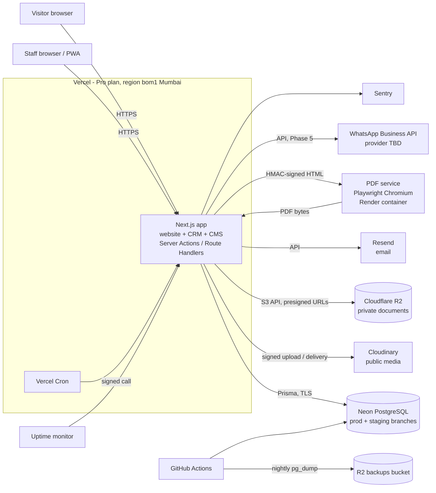

# Architecture

Status: **Phase 0 draft — awaiting approval.** Decisions marked *Proposed* need the owner's or developer's OK before Phase 1 starts.
Last updated: 2026-10-23.

## 1. What we are building

One Next.js application that serves three audiences from one codebase and one design system:

| Surface | Users | Route group | Indexed |
|---|---|---|---|
| Public website (EN + HI) | Couples, families, corporate planners | `src/app/(website)/[locale]/` | Yes |
| CRM | Staff (sales, accounts, operations, kitchen, managers) | `src/app/admin/` | No (`noindex`, blocked in robots) |
| CMS | Admins and content editors | `src/app/admin/cms/` | No |

Scope is venues and banquet halls only. There is no room-booking model, route, or copy anywhere.

## 2. System context



## 3. Stack and versions

Versions are the current stable releases checked on npm on 2026-10-23. Exact versions are pinned in `package.json` during Phase 1 and upgraded deliberately afterwards.

| Concern | Choice | Version line | Notes |
|---|---|---|---|
| Runtime | Node.js | 24 LTS | Installed locally: v24.11.1. |
| Framework | Next.js App Router | 16.4.x | |
| UI library | React | 19.x | |
| Language | TypeScript, `strict: true` | **6.0.x** | 7.0 is out, but Next.js only type-checks it through an experimental CLI flag, and lint/test tooling still uses the JS compiler API. Revisit in Phase 6. |
| Styling | Tailwind CSS | 4.3.x | Tokens mapped with `@theme` in `globals.css`. |
| Components | shadcn/ui + Radix, Lucide icons | latest CLI | Copied into `src/components/ui`, themed by tokens. |
| Forms | React Hook Form + Zod | 7.x / 4.x | Zod schemas shared in `src/lib/validation/`. |
| ORM / DB | Prisma + `@prisma/adapter-pg`, PostgreSQL 17 | **7.10.x** | npm's `latest` tag for the `prisma` CLI currently points at an 8.0 release candidate; we pin the stable 7.10 line for both CLI and client. |
| Auth | Better Auth | 1.7.x | *Proposed.* See ADR-05. |
| i18n | next-intl | 4.x | |
| Money | decimal.js (via `Prisma.Decimal`) | 10.x | |
| Dates | `date-fns` + `@date-fns/tz` | latest | All display in `Asia/Kolkata`. |
| Rich text | Tiptap (ProseMirror JSON) | latest | See ADR-13. |
| Media | Cloudinary Node SDK + `next-cloudinary` | 2.x | |
| Private storage | `@aws-sdk/client-s3` against Cloudflare R2 | 3.x | |
| PDF | Playwright Chromium (separate service) | 1.64.x | |
| Email | Resend SDK + React Email | latest | |
| Errors | Sentry (`@sentry/nextjs`) | 11.x | |
| Tests | Vitest, Playwright Test | 5.x / 1.64.x | |
| Package manager | npm | 11.x | The kit's commands assume npm. |

Not installed on this machine: Docker, PostgreSQL client tools. See §7 for how local development works without them.

## 4. Decision records

Each record states the decision, why, what was rejected, and what would make us revisit it.

### ADR-01 Modular monolith on Next.js — *Accepted (from requirements)*
One app, one database, one design system. Business logic lives in `src/server/services/`, data access in `src/server/repositories/`, authorization in `src/server/policies/`. The only separate deployable is the PDF renderer (ADR-08).
Revisit if: a module needs independent scaling or a different runtime.

### ADR-02 Hosting: Vercel Pro, Mumbai region — *Proposed*
- Vercel's fair-use guidelines state that all commercial use requires Pro or Enterprise; the free Hobby plan is not an option for a business site, including one built by a paid contractor.
- Pro gives preview deployments per branch, cron jobs, cookieless Web Analytics, instant rollback, and a function region in Mumbai (`bom1`) close to users and to the database.
- Rejected: running everything in one container on Render (one bill, Chromium in-process). It is cheaper only at the smallest size, and a 512 MB instance cannot comfortably run Next.js and Chromium together; a 2 GB instance costs about the same as Vercel Pro + a small PDF service, with worse global edge caching for the public site.
- Rejected: self-managed VPS. Lowest cost, but patching, TLS, backups and uptime become the developer's ongoing job.
Revisit if: monthly cost must drop below ~$20, or Vercel terms change.

### ADR-03 Database: Neon PostgreSQL — *Proposed*
- Branches give isolated databases for local development, CI, preview deployments and staging at no extra cost on the free tier.
- Production runs on a paid plan (usage-based "Launch"): no hard monthly compute-hour cap that would suspend the database, and a longer point-in-time-restore window than the free plan's 6 hours.
- Independent nightly `pg_dump` to a private R2 bucket (ADR-11), so recovery never depends on one vendor. Restore is tested before launch and quarterly.
- Region: the closest Neon region to Mumbai available at setup (check for an India region first; otherwise Singapore).
- Rejected: Supabase free tier pauses inactive projects after 7 days and has no daily backups; Render free Postgres expires. Neither is acceptable for customer and payment records.
Revisit if: Neon pricing or regions change materially.

### ADR-04 Prisma 7 with raw SQL where Prisma can't express it — *Accepted*
- Prisma schema is the source of truth; migrations are generated with `prisma migrate dev` and reviewed.
- Things Prisma can't declare go into hand-written SQL inside migration files: `btree_gist` extension, the slot-overlap exclusion constraint, append-only triggers on financial tables, partial indexes.
- Money is `Decimal(12,2)`, rates `Decimal(5,2)`, timestamps `Timestamptz(3)`.

### ADR-05 Authentication: Better Auth — *Proposed*
- Self-hosted in our own PostgreSQL (users, sessions, accounts, verification), so no customer or staff data leaves our database.
- Has a first-party TOTP two-factor plugin with backup codes, which we enforce for Super Admin, Admin and Accounts.
- Database sessions with `HttpOnly`, `Secure`, `SameSite=Lax` cookies; sessions can be revoked instantly.
- Staff sign in with email + password (+ TOTP). No social login. There are no customer accounts.
- Authorization (roles → permissions) is our own tables and `assertPermission()`; we don't rely on the auth library's role plugin, because the permission matrix is a business artefact we must test directly.
- Rejected: Auth.js v5 (still a beta release line, no built-in TOTP); hosted identity providers (cost, data residency, another vendor holding staff identities).

### ADR-06 Public media: Cloudinary — *Accepted (from requirements)*
- Signed server-side uploads only; credentials never reach the browser.
- Delivery via `next/image` with a Cloudinary loader: AVIF/WebP, responsive widths.
- Asset metadata (alt text EN/HI, caption, photographer credit, usage permission, category) lives in our `MediaAsset` table, not in Cloudinary.
- **Risk:** the free plan's 25 monthly credits are shared by storage, transformations and bandwidth, and video bandwidth burns them fastest. A 3 MB hero film viewed 10,000 times is ~30 GB. Mitigation: track usage from the first week. If credits run short, serve the encoded hero MP4/WebM from Vercel or a public R2 bucket and keep Cloudinary for images. See `docs/costs.md`.

### ADR-07 Private documents: Cloudflare R2 — *Proposed*
- Separate private bucket (no public access, no custom domain) behind `src/lib/storage/private.ts` with `put`, `getSignedDownloadUrl(key, ttlSeconds)`, `delete`. Any S3-compatible provider can replace it.
- Downloads go through a server route that checks the permission, writes an audit entry, then redirects to a presigned URL valid for 5 minutes. Object keys are random UUIDs, not names.
- Rejected: Cloudinary authenticated assets. It would put identity documents in the same account as public marketing media, where one wrong upload preset or delivery type makes them public. R2 also has no egress fees.

### ADR-08 PDF rendering: separate Playwright service on Render — *Proposed (required decision in Phase 0/1)*
- The main app renders the document to HTML with the same React template used for the on-screen preview, so preview and PDF can't drift.
- It POSTs that HTML to `pdf-service/` (a small Node + Playwright container in this repo, deployed on Render's Starter instance) with an HMAC-SHA256 signature over body + timestamp. The service rejects unsigned, stale (> 60 s) or oversized requests, has no database access, and never fetches external URLs (fonts and logo are baked into the image).
- The app stores the PDF in R2 and a `GeneratedDocument` row with a hash.
- Why not on Vercel: packaging Chromium into serverless functions works, but it is fragile, cold starts are slow, and font handling (Devanagari) is the hardest part to get right. A container with fonts installed is predictable.
- Rejected: hosted PDF APIs (cost per document, customer data sent to a third party).
- Only needed from Phase 3; the cost starts then.

### ADR-09 Internationalisation: next-intl, localized JSON fields — *Proposed*
- Public routes are `/{locale}/…` with `en` (default) and `hi`. CRM is English only.
- CMS text fields are stored as `LocalizedText` JSON: `{ "en": "…", "hi": "…" }`, validated by Zod. A single helper `t(field, locale)` falls back to English when Hindi is empty.
- Chosen over a generic `Translation` table: no extra joins, edits are atomic, and fallback is trivial. Trade-off: Hindi text isn't indexed for search, which we don't need.
- `hreflang` alternates and canonical URLs are generated from the same route map as the sitemap.

### ADR-10 Notifications: outbox + provider adapters — *Accepted*
- `NotificationService.send({ channel, template, to, data, purpose })` checks consent, writes an `Outbox` row and an in-app `Notification` in the same transaction as the business change, then a worker delivers it.
- Adapters: in-app (always), email (Resend), WhatsApp (provider chosen in Phase 5: Meta Cloud API directly, or an Indian BSP), SMS (only if needed, DLT registration required).
- With no provider configured, the status is `NOT_SENT_NO_PROVIDER` and the CRM says so. We never claim a message was sent.
- "Chat on WhatsApp" buttons in the CRM are plain `wa.me` links and need no provider.

### ADR-11 Scheduled work — *Proposed*
- Vercel Cron calls `/api/cron/*` route handlers authenticated with a secret header:
  - every 15 min: deliver outbox, retry failures with backoff;
  - hourly: release expired holds, promote waitlist, send hold-expiry and payment-due reminders;
  - daily: follow-up digests, retention review flags, invoice-sequence sanity check.
- Hold expiry is also applied lazily on read, so availability is correct even if a cron run is missed.
- Backups: GitHub Actions nightly `pg_dump` (custom format, encrypted) to the R2 backups bucket. Retention: 30 dailies + 12 monthlies.

### ADR-12 Rate limiting in PostgreSQL — *Proposed*
- Fixed-window counters in a small `RateLimitBucket` table keyed by `(endpoint, hashed IP or phone, window)`, cleaned up daily. No extra service needed at this traffic level.
- Applies to enquiry, date check, site visit, brochure, login and 2FA endpoints.
- Revisit if: sustained traffic makes this table hot; move to Upstash Redis.

### ADR-13 Rich text as structured JSON — *Proposed*
- CMS and blog bodies are edited with Tiptap and stored as ProseMirror JSON.
- Rendered server-side by our own renderer with an allowlist of nodes and marks (headings, paragraphs, lists, links, images from `MediaAsset`, quotes). No `dangerouslySetInnerHTML`. Links get `rel="noopener"` and are validated (http/https/mailto/tel only).

### ADR-14 Money and tax — *Accepted (from requirements)*
- All arithmetic in `src/lib/money/` using decimal.js with `ROUND_HALF_UP` to 2 places per tax component. React components only format.
- Tax rates and SAC codes come from Settings, are snapshotted onto quotation versions and invoices, and are never read live when re-rendering an issued document.

### ADR-15 Concurrency guarantees — *Accepted*
- Double confirmation of the same hall time: PostgreSQL exclusion constraint on `SlotOccupancy` (see `docs/database-design.md`), plus a service-level check that produces friendly conflict messages. The constraint is the backstop; the service check is the explanation.
- Document numbers: `NumberSequence` row locked with `UPDATE … RETURNING` inside the transaction that creates the document. Gap-free per type and financial year.
- Payments: unique `idempotencyKey` per form submission.
- Ledgers and issued invoices: append-only, enforced by database triggers as well as code.

### ADR-16 Time — *Accepted*
- Store `timestamptz` in UTC. Convert at the edges with `@date-fns/tz` (`Asia/Kolkata`). A slot's range is built from the event date and slot times; if end ≤ start, end is the next day.
- Financial year labels (`2026-27`) are computed from the Asia/Kolkata date, not UTC.

### ADR-17 Observability — *Proposed*
- Sentry for server and client errors (PII scrubbing on; no request bodies).
- Uptime monitor on `/` and `/api/health/enquiry` (checks DB connectivity without creating data). Alerts to the owner's email and phone.
- If the enquiry endpoint throws, Sentry alerts immediately and the visitor sees a fallback with the phone and WhatsApp number, so no enquiry is silently lost.

### ADR-18 Analytics — *Proposed*
- Vercel Web Analytics (cookieless) for page views, plus our own `ConversionEvent` table for enquiry submitted, WhatsApp click, call click, brochure download, site visit booked, date check used. Neither stores names or phone numbers.
- GA4 / Meta / Google Ads tags only if the business asks, and only after consent.

## 5. Code layout

Follows the master prompt's suggested structure, trimmed to what each phase actually needs. Folders are created when the first file needs them, not up front.

```
src/
  app/
    (website)/[locale]/      public pages
    (auth)/                  sign-in, 2FA
    admin/                   CRM + CMS (layout enforces session)
    api/                     route handlers: cron, uploads, downloads, health, webhooks
  components/
    ui/                      shadcn/ui (themed)
    website/ crm/ forms/ tables/ layout/ shared/
  modules/<domain>/          domain UI + server actions per module (leads, bookings, …)
  lib/                       framework-free helpers: money, validation, i18n, seo, storage, pdf, permissions
  server/
    services/                business logic (the only place rules live)
    repositories/            Prisma access
    policies/                permission checks and data shaping
prisma/                      schema.prisma, migrations/, seed.ts
pdf-service/                 Dockerfile + tiny HTTP server (Phase 3)
tests/                       unit/, integration/, e2e/
docs/
```

### Request pattern (every protected mutation)

```
Server Action / Route Handler
  → getSession()                       401 if none
  → assertPermission(user, 'key', res) 403 if denied
  → schema.parse(input)                400 with field errors
  → service.doThing(user, input)       transaction, business rules, audit + activity log
  → shape output for the caller        only fields this role may see
```

## 6. Environments

| Env | App | Database | Storage | Email / WhatsApp |
|---|---|---|---|---|
| Local | `npm run dev` | Neon branch `dev-<name>` | R2 `dev` bucket, Cloudinary `dev/` folder | Logged only |
| CI | GitHub Actions | PostgreSQL service container | Mocked | Mocked |
| Preview | Vercel preview per branch | Neon branch per preview (optional) | dev bucket | Logged only |
| Staging | `staging.<domain>` | Neon branch `staging` | R2 `staging` bucket | Real email to staff only |
| Production | `<domain>` | Neon `main` | R2 `prod` buckets | Real |

## 7. Local development on this machine

Docker and PostgreSQL are not installed. Two options; Phase 1 uses the first unless the developer prefers the second:
1. **Neon dev branch** (no install): `DATABASE_URL` points at a personal branch. Integration tests use a separate `test` branch that is reset before each run.
2. **Native PostgreSQL 17 for Windows**: fastest tests, works offline. The `btree_gist` extension ships with the standard installer.

CI always uses a throwaway PostgreSQL container, so migrations are proven from scratch on every push.

## 8. Open questions

1. Accept Vercel Pro + Render PDF service (ADR-02, ADR-08), or optimise for lowest cost?
2. Accept Better Auth (ADR-05)?
3. Which accounts are opened in the business's name? (`docs/missing-business-info.md` §0)
4. Keep this kit folder as the repository root, or move it to a folder named `sundaram-palace`? (Work so far assumes this folder.)
