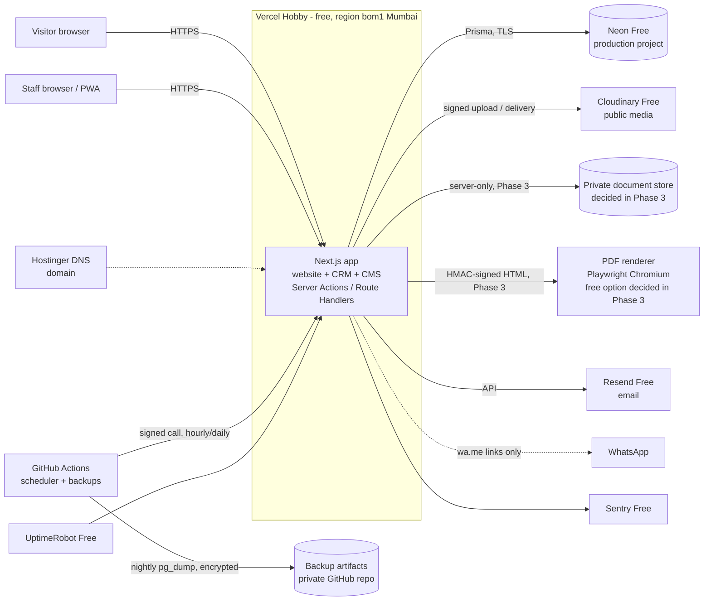

# Architecture

Status: **Phase 0 draft — awaiting approval.** Decisions marked *Proposed* need the owner's or developer's OK before Phase 1 starts.
Last updated: 2026-10-23.

**Owner decision (2026-10-23): run on free tiers only — Vercel Hobby, Neon Free, Cloudinary Free — and buy nothing now. The domain is already purchased at Hostinger.** The design below fits inside those free limits. Known risks of that choice are stated in ADR-02 and ADR-03, and `docs/costs.md` lists the signals that would make an upgrade worth discussing.

## 1. What we are building

One Next.js application that serves three audiences from one codebase and one design system:

| Surface | Users | Route group | Indexed |
|---|---|---|---|
| Public website (EN + HI) | Couples, families, corporate planners | `src/app/(website)/[locale]/` | Yes |
| CRM | Staff (sales, accounts, operations, kitchen, managers) | `src/app/admin/` | No (`noindex`, blocked in robots) |
| CMS | Admins and content editors | `src/app/admin/cms/` | No |

Scope is venues and banquet halls only. There is no room-booking model, route, or copy anywhere.

## 2. System context



## 3. Stack and versions

Versions are the current stable releases checked on npm on 2026-10-23. Exact versions are pinned in `package.json` during Phase 1 and upgraded deliberately afterwards.

| Concern | Choice | Version line | Notes |
|---|---|---|---|
| Runtime | Node.js | 24 LTS | Installed locally: v24.11.1. |
| Framework | Next.js App Router | 16.4.x | |
| UI library | React | 19.x | |
| Language | TypeScript, `strict: true` | **5.9.x** | The line `create-next-app` 16.4 installs and typescript-eslint supports. 7.0 is out, but Next.js only type-checks it through an experimental CLI flag. Revisit in Phase 6. |
| Styling | Tailwind CSS | 4.3.x | Tokens mapped with `@theme` in `globals.css`. |
| Components | shadcn/ui + Radix, Lucide icons | latest CLI | Copied into `src/components/ui`, themed by tokens. |
| Forms | React Hook Form + Zod | 7.x / 4.x | Zod schemas shared in `src/lib/validation/`. |
| ORM / DB | Prisma + `@prisma/adapter-pg`, PostgreSQL 17 | **7.10.x** | npm's `latest` tag for the `prisma` CLI currently points at an 8.0 release candidate; we pin the stable 7.10 line for both CLI and client. |
| Auth | Better Auth | 1.7.x | *Proposed.* See ADR-05. Free, self-hosted. |
| i18n | next-intl | 4.x | |
| Money | decimal.js (via `Prisma.Decimal`) | 10.x | |
| Dates | `date-fns` + `@date-fns/tz` | latest | All display in `Asia/Kolkata`. |
| Rich text | Tiptap (ProseMirror JSON) | latest | See ADR-13. |
| Media | Cloudinary Node SDK + `next-cloudinary` | 2.x | |
| Private storage | `src/lib/storage/private.ts` abstraction | — | Backend chosen in Phase 3 (ADR-07). |
| PDF | Playwright Chromium | 1.64.x | Where it runs is chosen in Phase 3 (ADR-08). |
| Email | Resend SDK + React Email | latest | |
| Errors | Sentry (`@sentry/nextjs`) | 11.x | |
| Tests | Vitest, Playwright Test | 5.x / 1.64.x | |
| Package manager | npm | 11.x | The kit's commands assume npm. |

Not installed on this machine: Docker, PostgreSQL client tools on PATH (a PostgreSQL 18 Windows service exists but is not used by this project). See §7.

## 4. Decision records

Each record states the decision, why, what was rejected, and what would make us revisit it.

### ADR-01 Modular monolith on Next.js — *Accepted (from requirements)*
One app, one database, one design system. Business logic lives in `src/server/services/`, data access in `src/server/repositories/`, authorization in `src/server/policies/`. The only possible separate deployable is the PDF renderer (ADR-08).
Revisit if: a module needs independent scaling or a different runtime.

### ADR-02 Hosting: Vercel Hobby (free), Mumbai region — *Accepted (owner decision)*
- Free. Custom domain from Hostinger, automatic SSL, preview deployments protected by Vercel Authentication.
- Limits that shape the design (checked 2026-10-23; verify on Vercel's limits page): about 100 GB/month data transfer and 100 GB-hours of function execution; **cron jobs run at most once a day** and only somewhere within the scheduled hour; Hobby is a personal account, so there are no team seats (the client can't be added as a member).
- Design consequences:
  - Public pages are statically generated and revalidated on CMS publish, so ordinary visits cost almost no function time and don't wake the database.
  - Time-sensitive work doesn't depend on Vercel Cron: notifications are sent right after the action with Next.js `after()`, holds expire lazily on read, and hourly/daily jobs are triggered by GitHub Actions (ADR-11).
  - Web Analytics custom events are not available on Hobby, so conversions go into our own table (ADR-18).
- **Known risk:** Vercel's fair-use guidelines say Hobby is for personal, non-commercial use and that all commercial use, including paid work for a client, needs Pro. Vercel could restrict or pause the project. Mitigation: the app is standard Next.js with no Vercel-only features, so it can move to Vercel Pro or another host without code changes. Third-party comparisons report that Netlify's free plan allows commercial use, but this is not yet verified against Netlify's terms or tested with this app.
- Rejected for now: Vercel Pro (owner: buy nothing now); a single container on Render (free tier sleeps after 15 minutes, which is unacceptable for the public site).

### ADR-03 Database: Neon Free — *Accepted (owner decision)*
- **Two Neon projects:** `sundaram-prod` (production `main` branch + `staging` branch) and `sundaram-dev` (developer and test branches). Compute hours are counted per project, so development and test runs never use up production's allowance.
- Free-plan limits that matter (checked 2026-10-23; sources partly disagree): 100 compute-hours per project per month, scale-to-zero after 5 minutes idle, ~0.5–1 GB storage, **6-hour restore window**. Hitting a monthly limit **suspends compute until the next cycle**.
- Design consequences:
  - Static public pages (ADR-02) keep the database asleep for normal visitors; it wakes for enquiries and staff work.
  - Nightly encrypted `pg_dump` (ADR-11) because the free restore window is only 6 hours.
  - If the database is unreachable, the enquiry form shows the phone and WhatsApp number instead of failing silently, and Sentry alerts.
  - Usage is checked monthly; at ~70% of compute hours or storage we discuss an upgrade (see `docs/costs.md`).
- Region: the closest Neon region to Mumbai available at setup (check for India first; otherwise Singapore).
- Rejected: Supabase free (pauses after 7 days of inactivity, no daily backups); Render free Postgres (expires).

### ADR-04 Prisma 7 with raw SQL where Prisma can't express it — *Accepted*
- Prisma schema is the source of truth; migrations are generated with `prisma migrate dev` and reviewed.
- Things Prisma can't declare go into hand-written SQL inside migration files: `btree_gist` extension, the slot-overlap exclusion constraint, append-only triggers on financial tables, partial indexes.
- Money is `Decimal(12,2)`, rates `Decimal(5,2)`, timestamps `Timestamptz(3)`.

### ADR-05 Authentication: Better Auth — *Proposed*
- Free, self-hosted in our own PostgreSQL (users, sessions, accounts, verification), so no customer or staff data leaves our database.
- Has a first-party TOTP two-factor plugin with backup codes, which we enforce for Super Admin, Admin and Accounts.
- Database sessions with `HttpOnly`, `Secure`, `SameSite=Lax` cookies; sessions can be revoked instantly.
- Staff sign in with email + password (+ TOTP). No social login. There are no customer accounts.
- Authorization (roles → permissions) is our own tables and `assertPermission()`; we don't rely on the auth library's role plugin, because the permission matrix is a business artefact we must test directly.
- Rejected: Auth.js v5 (still a beta release line, no built-in TOTP); hosted identity providers (cost, another vendor holding staff identities).

### ADR-06 Public media: Cloudinary Free — *Accepted (owner decision)*
- Signed server-side uploads only; credentials never reach the browser.
- Delivery via `next/image` with a Cloudinary loader: AVIF/WebP, responsive widths.
- Asset metadata (alt text EN/HI, caption, photographer credit, usage permission, category) lives in our `MediaAsset` table, not in Cloudinary.
- **Risk:** the free plan's 25 monthly credits are shared by storage, transformations and bandwidth (1 credit ≈ 1 GB). Video bandwidth burns them fastest: a 3 MB hero film viewed 10,000 times is ~30 GB, more than the whole allowance. Decision: **the compressed hero film is served from the app's own static files on Vercel** (`public/media/`), and Cloudinary handles images. The film is replaced by a deploy, not via the CMS; the poster image stays CMS-managed.

### ADR-07 Private documents — *Deferred to Phase 3*
Needed only from Phase 3 (customer and bride/groom documents, generated PDFs). Everything goes through `src/lib/storage/private.ts` (`put`, `streamForDownload`, `delete`) so the backend can change without touching the CRM. Free options:

| Option | Cost | Notes |
|---|---|---|
| **A. Cloudinary `authenticated` assets, downloaded only through our server** (recommended under the free-only rule) | $0, no card | Uses the existing account. Files are uploaded server-side with `type: authenticated` into a separate folder, and are never delivered by a Cloudinary URL to the browser: our download route checks permission, writes the audit log and streams the file. Shares the 25 credits (documents are small). Risk: a misconfigured upload could make a file public, so private uploads go through one tested function and a test asserts the public URL returns 401/404. |
| B. Cloudflare R2 private bucket | $0 within 10 GB, **but a card must be on file** to enable R2 | Cleanest separation; S3-compatible. |

Decision recorded at the start of Phase 3.

### ADR-08 PDF rendering — *Deferred to Phase 3*
- In every option, the main app renders the document to HTML with the same React template used for the on-screen preview, so preview and PDF can't drift.
- Free options:

| Option | Cost | Trade-off |
|---|---|---|
| **A. Small Playwright container (`pdf-service/`) on Render's free web service** (recommended) | $0 | Sleeps after 15 min idle; first PDF after a pause takes ~1 minute. Mitigated by waking it in the background as soon as a user opens the PDF dialog. Requests are HMAC-signed; the service has no DB access and blocks all outbound network calls; fonts (incl. Devanagari) are baked into the image. |
| B. Chromium inside a Vercel function (`@sparticuz/chromium`) | $0 | No extra service, but large bundles, slow cold starts and fragile font handling on serverless. Will be tried in a short spike if A is not acceptable. |
| C. Browser print ("Save as PDF") from the preview page | $0 | Always available as the "Print" button. No server-stored copy, so not enough on its own for invoices. |

- Generated PDFs are stored in the private store (ADR-07) with a `GeneratedDocument` row and hash.

### ADR-09 Internationalisation: next-intl, localized JSON fields — *Proposed*
- Public routes are `/{locale}/…` with `en` (default) and `hi`. CRM is English only.
- CMS text fields are stored as `LocalizedText` JSON: `{ "en": "…", "hi": "…" }`, validated by Zod. A single helper `t(field, locale)` falls back to English when Hindi is empty.
- Chosen over a generic `Translation` table: no extra joins, edits are atomic, and fallback is trivial. Trade-off: Hindi text isn't indexed for search, which we don't need.
- `hreflang` alternates and canonical URLs are generated from the same route map as the sitemap.

### ADR-10 Notifications: outbox + provider adapters — *Accepted*
- `NotificationService.send({ channel, template, to, data, purpose })` checks consent and writes an `Outbox` row and an in-app `Notification` in the same transaction as the business change. Delivery is attempted immediately after the response (`after()`); failures are retried by the scheduled job.
- Adapters: in-app (always), email (Resend Free: 100/day, 3,000/month), WhatsApp, SMS.
- **WhatsApp in free mode:** "Chat on WhatsApp" buttons are plain `wa.me` links (free, no API). Automated WhatsApp messages (reminders, greetings) are charged per message by Meta, so the adapter stays switched off until the business decides to pay; those notifications go by email and in-app instead.
- With no provider configured, the status is `NOT_SENT_NO_PROVIDER` and the CRM says so. We never claim a message was sent.

### ADR-11 Scheduled work and backups — *Accepted*
- Vercel Hobby cron runs only once a day, so **GitHub Actions scheduled workflows** call `/api/cron/*` route handlers authenticated with a secret header:
  - hourly: release expired holds, promote waitlist, retry failed outbox messages, hold-expiry reminders;
  - daily (06:00 IST): follow-up digest, payment-due reminders, retention flags, invoice-sequence check, prune rate-limit buckets.
- GitHub's scheduler can run late by several minutes, so nothing depends on exact timing: hold expiry is also applied lazily on every read, and notifications are sent immediately when the action happens.
- **Backups:** a nightly GitHub Actions job runs `pg_dump` (PostgreSQL 17 client), encrypts the dump with `age` (public key in the repo; private key held offline by the owner and developer), and stores it as a workflow artifact in the private repo with 30-day retention. On the 1st of each month the owner downloads that day's encrypted dump to the business's own storage (e.g. Google Drive). Restore is tested before launch and quarterly.
- Free-tier budget: an hourly job uses ~720 of GitHub Free's 2,000 private-repo Actions minutes per month, leaving room for CI (verify the current allowance). If minutes run short, the scheduler drops to every 2 hours.

### ADR-12 Rate limiting in PostgreSQL — *Proposed*
- Fixed-window counters in a small `RateLimitBucket` table keyed by `(endpoint, hashed IP or phone, window)`, cleaned up daily. No extra service.
- Applies to enquiry, date check, site visit, brochure, login and 2FA endpoints.
- Revisit if: sustained traffic makes this table hot; move to Upstash Redis (free tier).

### ADR-13 Safe CMS text — *Accepted (Phase 2)*
- Phase 2 stores CMS bodies as a small Markdown subset per language (`## heading`, paragraphs, `-`/`1.` lists, `**bold**`, `*italic*`, `[link](https://…)`), rendered by our own React renderer in `src/lib/content/rich-text.tsx`. Raw HTML is never interpreted (`dangerouslySetInnerHTML` is not used); links are limited to http/https/mailto/tel/relative and external ones get `rel="noopener noreferrer"`. Tested in `tests/unit/content.test.tsx`.
- Chosen over Tiptap for now: no editor dependency, plain text is easy for staff and safe by construction. A rich editor can be revisited for the blog in Phase 5.

### ADR-14 Money and tax — *Accepted (from requirements)*
- All arithmetic in `src/lib/money/` using decimal.js with `ROUND_HALF_UP` to 2 places per tax component. React components only format.
- Tax rates and SAC codes come from Settings, are snapshotted onto quotation versions and invoices, and are never read live when re-rendering an issued document.

### ADR-15 Concurrency guarantees — *Accepted*
- Double confirmation of the same hall time: PostgreSQL exclusion constraint on `SlotOccupancy` (see `docs/database-design.md`), plus a service-level check that produces friendly conflict messages. The constraint is the backstop; the service check is the explanation.
- Document numbers: `NumberSequence` row locked with `UPDATE … RETURNING` inside the transaction that creates the document. Gap-free per type and financial year.
- Payments: unique `idempotencyKey` per form submission.
- Ledgers and issued invoices: append-only, enforced by database triggers as well as code.

### ADR-16 Time — *Accepted*
- Store `timestamptz` in UTC. Convert at the edges with `@date-fns/tz` (`Asia/Kolkata`). A slot's range is built from the event date and slot times; if end ≤ start, end is the next day.
- Financial year labels (`2026-27`) are computed from the Asia/Kolkata date, not UTC.

### ADR-17 Observability — *Proposed*
- **Status:** `/api/health/enquiry` is built. Sentry is not installed yet; it is added with the Phase 2 launch, when a DSN exists to verify it against.
- Sentry Free for server and client errors (PII scrubbing on; no request bodies).
- UptimeRobot Free on `/` and `/api/health/enquiry` (checks DB connectivity without creating data). Alerts to the owner's email.
- If the enquiry endpoint throws, Sentry alerts immediately and the visitor sees a fallback with the phone and WhatsApp number, so no enquiry is silently lost.

### ADR-18 Analytics — *Accepted (Phase 2: conversions only)*
- **Status:** conversion events (enquiry submitted, WhatsApp click, call click) are stored in `ConversionEvent` via `/api/events` (no cookies, no personal data, rate-limited). UTM/referrer attribution lives in `sessionStorage` until an enquiry is sent. Because nothing non-essential is stored in the browser, no cookie-consent banner is shown; one is required before adding GA4 or ad pixels.
- Our own `ConversionEvent` table for enquiry submitted, WhatsApp click, call click, brochure download, site visit booked, date check used — no names or phone numbers.
- Page views: Vercel Web Analytics within the Hobby allowance (cookieless), or Google Analytics 4 (free) loaded only after consent if the business wants richer reports.
- Meta / Google Ads tags only if the business asks, and only after consent.

## 5. Code layout

Follows the master prompt's suggested structure, trimmed to what each phase actually needs. Folders are created when the first file needs them, not up front.

```
src/
  app/
    (website)/[locale]/      public pages
    (auth)/                  sign-in, 2FA
    admin/                   CRM + CMS (layout enforces session)
    api/                     route handlers: cron, uploads, downloads, health, webhooks
  components/
    ui/                      shadcn/ui (themed)
    website/ crm/ forms/ tables/ layout/ shared/
  modules/<domain>/          domain UI + server actions per module (leads, bookings, …)
  lib/                       framework-free helpers: money, validation, i18n, seo, storage, pdf, permissions
  server/
    services/                business logic (the only place rules live)
    repositories/            Prisma access
    policies/                permission checks and data shaping
prisma/                      schema.prisma, migrations/, seed.ts
pdf-service/                 Dockerfile + tiny HTTP server (Phase 3, if ADR-08 option A)
.github/workflows/           ci.yml, scheduler.yml, backup.yml
tests/                       unit/, integration/, e2e/
docs/
```

### Request pattern (every protected mutation)

```
Server Action / Route Handler
  → getSession()                       401 if none
  → assertPermission(user, 'key', res) 403 if denied
  → schema.parse(input)                400 with field errors
  → service.doThing(user, input)       transaction, business rules, audit + activity log
  → shape output for the caller        only fields this role may see
```

## 6. Environments

| Env | App | Database | Media / documents | Email |
|---|---|---|---|---|
| Local | `npm run dev` | Neon project `sundaram-dev`, branch `dev` | Cloudinary `dev/` folder | Logged only |
| Test / CI | Vitest + Playwright; GitHub Actions | CI: PostgreSQL service container. Local: Neon `sundaram-dev`, branch `test` (reset per run) | Mocked | Mocked |
| Preview | Vercel preview per branch (Vercel Authentication on) | Neon `sundaram-dev` | Cloudinary `dev/` | Logged only |
| Staging | `staging.<domain>` (Vercel branch domain, protected, `noindex`) | Neon `sundaram-prod`, branch `staging` | Cloudinary `staging/` | Real email to staff only |
| Production | `<domain>` | Neon `sundaram-prod`, branch `main` | Cloudinary `prod/` | Real |

## 7. Local development on this machine

**Implemented in Phase 1:** `npm run db:local` starts a real PostgreSQL 17 inside the project via the `embedded-postgres` package (no Docker, no system install), UTF-8 encoded, on port 54329 with data in `.local/pgdata`. It hosts three databases: `sundaram_dev` (development), `sundaram_test` (rebuilt from migrations by every `npm run test`) and `sundaram_e2e` (rebuilt by every `npm run test:e2e`).

A Neon `sundaram-dev` project remains an option for working from another machine.

CI always uses a throwaway PostgreSQL container, so migrations are proven from scratch on every push.

## 8. Open questions

1. Accept Better Auth (ADR-05)?
2. Whose name are the free accounts opened in? (Vercel Hobby is a personal account; see `docs/missing-business-info.md` §0.)
3. Keep this kit folder as the repository root? (Work so far assumes yes.)
4. Phase 3: private document store (ADR-07) and PDF renderer (ADR-08) — free options listed; decide when Phase 3 starts.
