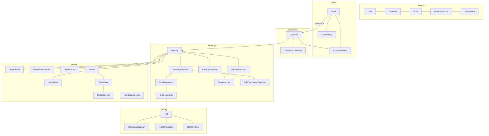

# Database design

Status: **Phase 0 draft.** This is the target model. Tables are created phase by phase (see the "Phase" column); each migration updates this document in the same commit (`db-change-safety` skill).
Last updated: 2026-10-23.

## 1. Conventions

| Topic | Rule |
|---|---|
| IDs | `String @id @default(cuid())` (or UUIDv7). Never expose sequential IDs publicly. |
| References | Human-readable, `@unique`: lead `SP-L-2026-00042`, booking `SP-B-2026-00017`, invoices per financial year with a prefix from Settings. |
| Money | `Decimal @db.Decimal(12, 2)`. Rates and percentages `Decimal @db.Decimal(5, 2)`. Never `Float`. |
| Timestamps | `DateTime @db.Timestamptz(3)`; `createdAt @default(now())`, `updatedAt @updatedAt`. Stored in UTC, shown in `Asia/Kolkata`. |
| Calendar dates | Event dates without a time use `@db.Date`, interpreted in `Asia/Kolkata`. |
| Soft delete | `deletedAt` on Customer, Lead, Booking, Vendor, content pages. Queries exclude soft-deleted rows by default. |
| Deletion rules | `onDelete: Restrict` for anything touching bookings, payments, invoices, deposits, customers. `Cascade` only for pure child rows of drafts. |
| Snapshots | Quotation versions, booking menu/price selections, cancellation policy and invoices are immutable rows or JSON snapshots, never derived live from editable catalog tables. |
| Localized text | `Json` holding `{ en: string, hi?: string }`, validated by a shared Zod schema. |
| Configurable lists | `LookupValue(listKey, key, label, sortOrder, active, systemKey?)`. Logic depends only on `systemKey` (e.g. lead status `NEW`, `WON`, `LOST`), never on labels. |
| Audit | Every sensitive change writes `AuditLog`; every user-visible event writes `ActivityLog`. |

## 2. Domain map



## 3. Entities by domain

### 3.1 Access and settings (Phase 1)

| Entity | Key fields | Notes |
|---|---|---|
| `User` | name, email (unique), active, lastLoginAt | Managed with Better Auth tables `Session`, `Account`, `Verification`, `TwoFactor`. |
| `Role` | key, name, system | Super Admin, Admin, Manager, Sales, Accounts, Event Operations, Kitchen. |
| `Permission` | key (e.g. `leads.read`), description | Seeded from code; the code registry is the source of truth. |
| `RolePermission`, `UserRole` | join tables | Changes are audit-logged. |
| `SiteSetting` | key, value Json, updatedBy | Typed sections validated by Zod: business, tax, numbering, booking policy, notifications, SEO, retention. |
| `LookupValue` | listKey, key, label (Localized), sortOrder, active, systemKey | Lead statuses, sources, lost reasons, event types, customer categories, professions, menu categories, service categories. |
| `TaxCategory` | name, sacCode, ratePercent, effectiveFrom, effectiveTo | Rates are versioned by date so old invoices keep their rate. Must be confirmed by the accountant. |
| `NumberSequence` | type, financialYear, prefix, nextValue | Unique `(type, financialYear)`. |
| `AuditLog` | actorId, action, entityType, entityId, before/after summary Json, ip, userAgent, at | Append-only. No document contents, no secrets. |
| `ActivityLog` | entityType, entityId, actorId, kind, message, data, at | Timeline shown on lead, customer and booking pages. |
| `RateLimitBucket` | key, windowStart, count | Pruned daily. |

### 3.2 CMS and website (Phase 2, extended in Phase 5)

| Entity | Key fields |
|---|---|
| `MediaAsset` | provider (cloudinary), publicId, kind (image/video/pdf), width, height, alt (Localized, en required), caption, photographerCredit, usagePermission, group, uploadedBy |
| `WebsitePage` | slug, title (Localized), seo Json (meta title/description per locale, ogImageId), published, publishedAt |
| `PageSection` | pageId, type (hero, intro, halls, catering, decor, packages, gallery, stories, dates, blog, cta, map), sortOrder, visible, content Json |
| `NavigationItem` | location (header/footer), label (Localized), href, sortOrder |
| `GalleryCategory`, `GalleryItem` | category, mediaAssetId, featured, sortOrder |
| `DecorTheme` | name, description, mediaAssetIds, published |
| `AuspiciousDate` | date, label (Localized), note, season, published |
| `OfferPage` | slug, campaignKey, content Json, seo Json, startsAt, endsAt, published |
| `RealWeddingStory` | coupleNames, consentGiven, consentDate, consentRecordId, eventType, hallId, story (Localized), mediaAssetIds, published |
| `BlogPost`, `BlogCategory`, `BlogTag` | slug, title, excerpt, body (ProseMirror Json), status (DRAFT/SCHEDULED/PUBLISHED/UNPUBLISHED), publishAt, authorId, featuredImageId, seo Json |
| `Redirect` | fromPath (unique), toPath, permanent |
| `ConversionEvent` | type, page, locale, utm Json, at | No personal data. |

### 3.3 Leads (Phase 2)

| Entity | Key fields | Notes |
|---|---|---|
| `Lead` | reference, status (LookupValue), sourceId, campaign, utm Json (source, medium, campaign, term, content), referrer, landingPage, locale, eventTypeId, preferredDate, guestsApprox, message, preferredHallId, fullName, phone (E.164), email, contactPreference, assignedToId, followUpAt, budgetEstimate, menuPreference, siteVisitAt, siteVisitOutcome, lostReasonId, customerId, deletedAt | Index: phone, status, assignedToId + followUpAt, createdAt. |
| `LeadActivity` | leadId, kind (CALL, WHATSAPP, VISIT, NOTE, STATUS_CHANGE, MERGED_ENQUIRY), note, actorId, at | |
| `ConsentRecord` | subjectType (LEAD/CUSTOMER/PARTY), subjectId, purpose (contact, marketing_whatsapp, marketing_email, greetings, brochure), granted, noticeVersion, source, at | New row for every change; latest row wins. |
| `SiteVisitSlot` (Phase 5) | dayOfWeek, startTime, endTime, capacity, active | |

Duplicate enquiry rule: same normalized phone with an open lead created within the configured window → append a `MERGED_ENQUIRY` activity to the existing lead instead of creating a new one.

### 3.4 Customers (Phase 3)

| Entity | Key fields | Notes |
|---|---|---|
| `Customer` | reference, fullName, mobile (E.164, indexed), whatsapp, email, gstin, companyName, maritalStatus, dateOfBirth, anniversary, spouseName, categoryId, professionId, professionOther, state, city, locality, address, photoAssetId, notes, deletedAt, anonymizedAt | Age is computed, never stored. DOB/anniversary collected only if greetings are used. |
| `CustomerDocument` | ownerType (CUSTOMER/PARTY), ownerId, category (PAN, AADHAAR_MASKED, OTHER), storageKey, mimeType, sizeBytes, sha256, uploadedBy, purpose | File in the private document store (ADR-07). No Aadhaar number columns at all. |
| `CustomerMergeReview` | primaryId, duplicateId, status, decidedBy, decidedAt | Merge is a reviewed action, never automatic. |

### 3.5 Venue (Phase 2 public facts, Phase 3 booking rules)

| Entity | Key fields | Notes |
|---|---|---|
| `Hall` | name (Localized), slug, description (Localized), areaSqFt?, ceilingHeightFt?, facilities Json, floorPlanAssetId, tourUrl, eventTypeIds, isComposite, setupBufferMinutes, teardownBufferMinutes, active, sortOrder | Fact fields are nullable: unknown is shown as "coming soon", never as 0. |
| `HallLayoutCapacity` | hallId, layout (THEATRE, BANQUET, FLOATING, CLUSTER), minGuests?, maxGuests? | |
| `HallComposition` | compositeHallId, memberHallId | "Hall A + Hall B" is a composite hall made of two physical halls. |
| `SlotDefinition` | hallId (nullable = all halls), name (Localized), startTime, endTime, crossesMidnight (derived), active | Times are local `Asia/Kolkata` wall-clock times. |

### 3.6 Bookings (Phase 3)

| Entity | Key fields | Notes |
|---|---|---|
| `Booking` | reference, customerId, leadId?, mainEventName, mainEventTypeId, status (internal state machine), statusLabelId, startDate, endDate, expectedGuests, packageId?, acceptedQuotationVersionId?, cancellationPolicySnapshot Json, depositRequired, notes, internalInstructions, createdById, deletedAt | Totals are not stored as editable fields; they come from the accepted quotation version plus ledger. |
| `BookingSubEvent` | bookingId, name, eventTypeId, date, hallId, slotDefinitionId?, customStartsAt?, customEndsAt?, expectedGuests, assignedToId, specialInstructions, internalNotes, status, sortOrder | Each sub-event has its own date and hall. |
| `SlotReservation` | subEventId (unique), hallId, startsAt, endsAt, state (HOLD, TENTATIVE, CONFIRMED, RELEASED, CANCELLED), holdExpiresAt, waitlistPosition, overrideReason?, overrideById? | One per sub-event. |
| `SlotOccupancy` | reservationId, physicalHallId, effectiveStartsAt, effectiveEndsAt, state, allowOverlap | One row per *physical* hall (a composite hall produces one row per member). Effective range includes setup/teardown buffers. The exclusion constraint lives here. |
| `BrideGroomParty` | bookingId, role (BRIDE, GROOM), fullName, mobile, altContact Json | Shown when the main event type is a marriage event. |
| `BookingStatusHistory` | bookingId, from, to, reason, actorId, at | |

Booking internal states: `ENQUIRY_HOLD → TENTATIVE → QUOTATION_SENT → CONFIRMED → IN_PROGRESS → COMPLETED`, or `CANCELLED`. Transitions are validated in `bookingService`, not in the UI.

### 3.7 Catalog, menus and quotations (Phase 3)

| Entity | Key fields | Notes |
|---|---|---|
| `Service` | name, categoryId, taxCategoryId, defaultUnit, defaultPrice?, active | No room services. |
| `Package`, `PackageItem` | name, description, eventTypeIds, terms, defaultPrice? / perPlateRate?, minPlates, publicPrice (bool), active | |
| `Menu`, `MenuCourse`, `MenuItem` | category (Veg/Jain/Non-veg/custom), course, item name (Localized), dietary tags, publicVisible | Same data powers the website and the CRM. |
| `MenuPackage` | menuId, perPlateRate, selectionRules Json (e.g. `{ course: "starters", choose: 3, from: [ids] }`), minPlates | |
| `PricingRule` | kind (SEASON, WEEKDAY, DATE), dateRange / weekdays / dates, adjustment (percent or amount), appliesTo | Applied only when a new quotation version is drafted. |
| `CancellationPolicy` | name, slabs Json `[{ daysBeforeEventMin, refundPercent }]`, active | Snapshotted onto the booking at confirmation. |
| `SubEventMenuSelection` | subEventId, menuPackageId, snapshot Json (items, rate), guaranteedPlates, actualPlates?, lockedAt? | |
| `QuotationVersion` | bookingId, versionNumber, status (DRAFT, SENT, ACCEPTED, SUPERSEDED), snapshot Json (terms, tax config), subtotal, discountTotal, taxTotal, grandTotal, acceptedAt, acceptedById, createdById | Immutable once SENT; editing creates the next version. Unique `(bookingId, versionNumber)`. |
| `QuotationLine` | versionId, kind (PACKAGE, PLATES, SERVICE, CUSTOM, EXTRA_PLATES), description, sacCode, quantity, unit, unitPrice, discount, taxRatePercent, taxableValue, lineTotal, subEventId? | |

### 3.8 Money (Phase 3)

| Entity | Key fields | Notes |
|---|---|---|
| `LedgerEntry` | bookingId, type (PAYMENT, REFUND, ADJUSTMENT), amount (positive), direction, occurredOn, method (CASH, UPI, BANK_TRANSFER, CARD_OFFLINE, CHEQUE, OTHER), transactionRef, receiptNumber?, reason?, reversesEntryId?, recordedById, idempotencyKey (unique), createdAt | Append-only (trigger blocks UPDATE/DELETE). |
| `PaymentInstalment` | bookingId, label, dueOn, amount, sortOrder | The schedule; reminders read it. Paid status is computed from the ledger. |
| `DepositEntry` | bookingId, type (RECEIVED, DEDUCTION, REFUNDED), amount, reason, method, recordedById, idempotencyKey | Separate from revenue. Append-only. |
| `Invoice` | number (unique), financialYear, bookingId, issuedOn, supplier snapshot Json, recipient snapshot Json, placeOfSupplyStateCode, supplyType (INTRA/INTER), taxInclusive, totals, amountInWords, status (ISSUED, PARTIALLY_CREDITED, FULLY_CREDITED) | Immutable after issue (trigger). |
| `InvoiceLine` | invoiceId, description, sacCode, quantity, unit, taxableValue, ratePercent, cgst, sgst, igst, lineTotal | |
| `CreditNote`, `CreditNoteLine` | number (unique), invoiceId, reason, issuedOn, totals | Own number sequence. |

Outstanding balance (computed, never stored as truth):
`accepted quotation grand total + post-event charges − (Σ PAYMENT − Σ REFUND ± ADJUSTMENT)`. Deposits are excluded.

### 3.9 Documents, operations and messaging (Phases 3–5)

| Entity | Phase | Key fields |
|---|---|---|
| `DocumentTemplate` | 3 | type, key, name, isDefault, config Json |
| `DocumentPreset` | 3 | ownerId? (null = global), documentType, templateId, fields Json |
| `GeneratedDocument` | 3 | bookingId, type, templateId, fields Json, reference, version, storageKey, sha256, createdById |
| `Task`, `TaskTemplate` | 4 | title, description, assigneeId, dueAt, priority, status, linked entity, completedAt |
| `Vendor`, `VendorAssignment` | 4 | name, contact, categoryId, partner, notes / bookingId, subEventId |
| `Expense` | 4 | bookingId, categoryId, vendorId, amount, incurredOn, paymentStatus, notes |
| `Notification` | 2 | userId, kind, title, body, link, readAt |
| `Outbox` | 2 | channel, template, to (masked in UI), payload Json, purpose, status (PENDING, SENT, FAILED, NOT_SENT_NO_PROVIDER, SKIPPED_NO_CONSENT), attempts, nextAttemptAt, providerMessageId |
| `DataSubjectRequest` | 4 | subjectType, subjectId, kind (ACCESS, CORRECTION, DELETION), status, notes, handledById |

## 4. Critical constraints (raw SQL in migrations)

### 4.1 No overlapping confirmed occupancy of a physical hall

```sql
CREATE EXTENSION IF NOT EXISTS btree_gist;

ALTER TABLE "SlotOccupancy"
  ADD CONSTRAINT slot_occupancy_no_confirmed_overlap
  EXCLUDE USING gist (
    "physicalHallId" WITH =,
    tstzrange("effectiveStartsAt", "effectiveEndsAt", '[)') WITH &&
  )
  WHERE (state = 'CONFIRMED' AND NOT "allowOverlap");
```

- Covers buffers (effective range) and composite halls (one row per physical hall).
- `[)` ranges mean an event ending at 15:00 does not clash with one starting at 15:00 once buffers are applied.
- An authorized override sets `allowOverlap = true` with a reason and an audit entry; the service layer still shows the warning.
- Holds and tentative reservations are excluded from the constraint; the service reports them as warnings.
- Test: two concurrent confirmations of overlapping ranges → exactly one succeeds, the other gets a translated conflict error.

### 4.2 Gap-free document numbers

```sql
UPDATE "NumberSequence"
   SET "nextValue" = "nextValue" + 1
 WHERE type = $1 AND "financialYear" = $2
RETURNING "nextValue" - 1 AS allocated, prefix;
```

Run inside the same transaction that inserts the invoice. If the insert fails, the transaction rolls back and the number is not consumed. Sequences for a new financial year are created automatically on 1 April (Asia/Kolkata), starting from the value in Settings.

### 4.3 Append-only financial tables

Trigger on `LedgerEntry`, `DepositEntry`, `Invoice`, `InvoiceLine`, `CreditNote`, `CreditNoteLine`, `QuotationLine` (for non-draft versions), `AuditLog`: `BEFORE UPDATE OR DELETE … RAISE EXCEPTION`. The only allowed update is the invoice status column, by a narrow trigger exception.

## 5. Indexes (initial)

- `Lead(phone)`, `Lead(status, createdAt)`, `Lead(assignedToId, followUpAt)`, `Lead(reference)` unique.
- `Customer(mobile)`, `Customer` trigram index on `fullName` for search (`pg_trgm`).
- `SlotOccupancy(physicalHallId, effectiveStartsAt)` (plus the GiST index from the constraint).
- `SlotReservation(state, holdExpiresAt)` for the expiry job.
- `LedgerEntry(bookingId, occurredOn)`, `Invoice(financialYear, number)`.
- `Outbox(status, nextAttemptAt)`.

## 6. Data lifecycle

| Data | Deletion behaviour |
|---|---|
| Lead / Customer personal data | Soft delete; deletion requests anonymize personal fields (`anonymizedAt`) after checking legal retention. |
| Bookings, ledgers, invoices, credit notes | Never deleted. Retained for the period the accountant confirms. |
| Private documents | Object deleted from the private store when the retention period ends or on a valid deletion request; `CustomerDocument` row keeps metadata + `deletedAt`. |
| Audit log | Retained per Settings (proposed 3 years), then archived. |
| Rate-limit buckets, expired sessions | Hard-deleted by the daily job. |

## 7. Seeds

`prisma/seed.ts` creates only clearly fake data: users like `admin@example.test`, customers like "Test Customer 01", phones `+91 90000 000xx`, halls named "Sample Hall A/B", and a sample 5-day wedding with 6 sub-events and ~40 line items for PDF testing. Real customer data never goes into seeds or fixtures.
